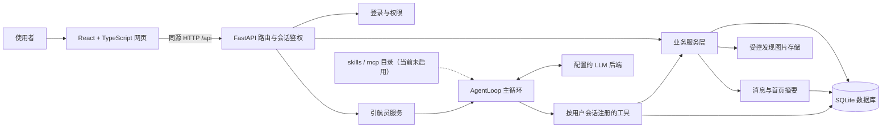
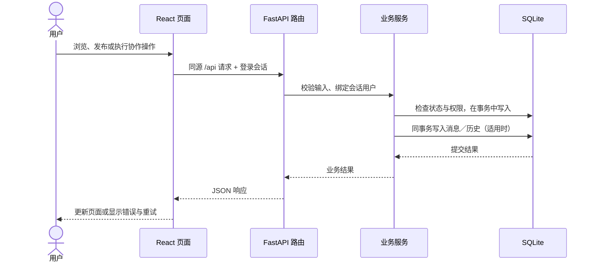
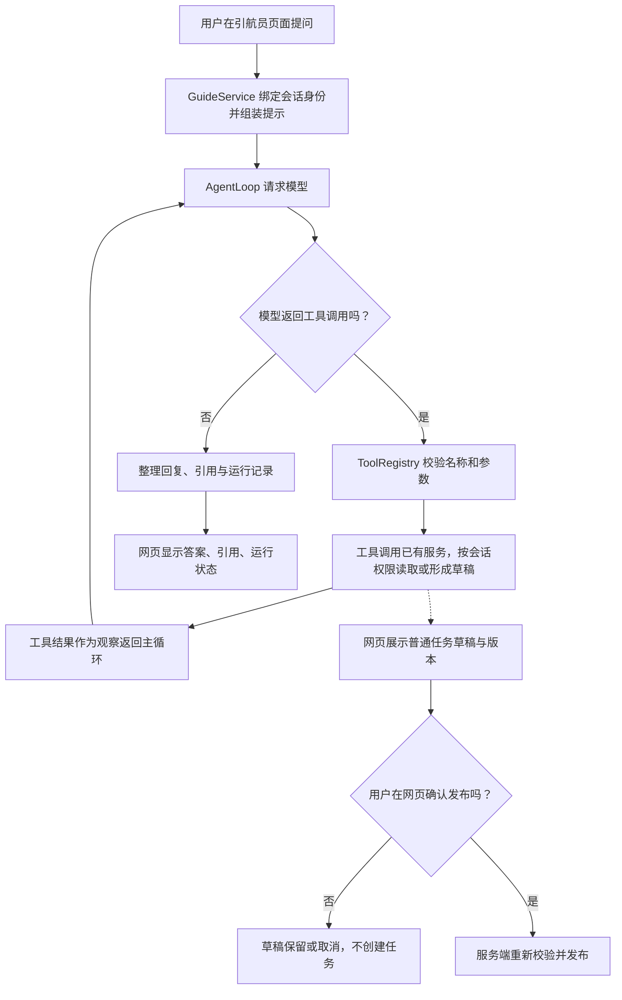

# 引航岛

引航岛面向校园互助与活动协作，以 AI Agent“引航员”为智能交互入口，协助志愿服务与综素活动组织者澄清需求、形成招募方案与筹备清单；参与者可授权技能、兴趣和时间偏好，由后台持续匹配机会并发送站内提醒。四类内容保持各自独立的业务规则。新增功能与验收方式见[活动筹备与参与助手](docs/PROPOSAL_ALIGNMENT.md)，结果见[申报书功能验收记录](docs/PROPOSAL_ACCEPTANCE.md)。

本文件说明项目由哪些部分组成、请求如何流转、各模块的边界以及如何运行。面向网页使用者的操作步骤见[界面使用说明](docs/USAGE.md)。

最新一轮加入结构化规划建议、后端方案检查、版本差异与语义标签推荐，使用方法、接口和复现命令见[活动规划与语义推荐改进](docs/AGENT_IMPROVEMENTS.md)，实际测试结果见[本轮验收记录](docs/AGENT_IMPROVEMENTS_ACCEPTANCE.md)。

## 功能范围

| 模块 | 当前能力 | 关键边界 |
|---|---|---|
| 普通任务 | 发布、直接接取或申请后确认、阶段协作、成果验收、截止与逾期、双方约定变更、暂停／恢复／取消、有偿约定及线下结算确认 | 一项任务一位接取者；平台不处理支付、不代替双方确认线下付款 |
| 综素活动 | 定时开放、限额报名、审核、候补与递补、个人报名和负责人名单管理 | 报名成功不等于获得正式综素认定；不包含签到或学校认定对接 |
| 志愿服务 | 分岗位报名、审核与候补、参与登记、服务分钟数及小时核验、个人记录 | 活动方确认不等于学校正式认定；没有线上签到签退 |
| 校园发现 | 图文发布、评论补充、发布者更新状态、编辑／撤回和历史 | 状态为发布者自报；平台不提供工作人员认证、紧急事件处置或内容审核工作台 |
| 首页与消息 | 四类内容入口、个人待办、完成协作数、持久站内消息、已读管理 | 持续匹配新机会并发送站内提醒；没有邮件、浏览器推送或私聊 |
| 引航员 | 志愿与综素活动规划草稿、岗位建议与筹备清单；偏好登记、持续匹配与推荐解释；真实业务查询；普通任务草稿与阶段建议；实时及历史调用轨迹 | 活动发布与偏好保存须用户确认；报名、审核、小时核验由本人或负责人操作；校园发现只读 |
| 账号 | 公开注册普通账号、登录、退出登录、账号资料查看及主机端账号维护 | 退出只撤销当前会话；普通用户没有删除入口；主机管理员可通过本地命令备份并删除无业务记录的非内置测试账号 |

## 系统构成



普通网页和引航员工具都通过业务服务读取或修改校园业务数据。服务层负责权限、状态规则、事务和通知，路由层负责 HTTP 输入输出；模型不会直接访问数据库，也不能通过工具参数伪造当前用户身份。

### 关键请求流程

普通页面请求：



引航员对话与普通任务草稿：



后台机会匹配服务按当前业务状态与已确认偏好持续生成推荐，提醒与推荐同事务提交，不依赖聊天请求。

AgentLoop 负责有限轮次的模型与工具调用、运行预算、取消和进度事件；GuideService 负责用户上下文、工具注册、提示及业务集成。只读工具复用任务、活动、志愿、发现和首页服务。草稿工具只整理待确认内容；最终发布走独立的网页确认接口和普通任务服务。

## 代码目录

| 路径 | 职责 |
|---|---|
| `campus/app.py` | 创建 FastAPI 应用、服务实例和路由；连接前端静态页面与 API |
| `campus/auth.py` | 登录会话、用户身份与访问控制基础 |
| `campus/service.py` | 普通任务主服务：发布、申请／接取、协作控制及业务事务 |
| `campus/stages.py`、`campus/terms.py`、`campus/changes.py` | 阶段协作、有效约定及双方变更申请 |
| `campus/activities.py`、`campus/activity_api.py` | 综素活动业务与接口 |
| `campus/volunteers.py`、`campus/volunteer_api.py` | 志愿服务、岗位报名及小时记录 |
| `campus/discoveries.py`、`campus/discovery_api.py` | 校园发现、评论、状态、图片和历史 |
| `campus/home.py`、`campus/home_api.py`、`campus/notifications.py` | 个人待办、首页摘要和站内消息 |
| `campus/guide.py`、`campus/drafts.py`、`campus/runs.py` | 引航员编排、草稿、运行记录和流式接口 |
| `agent/loop.py`、`agent/context.py`、`agent/prompts.py` | 与校园领域解耦的 Agent 主循环及上下文基础 |
| `backend/client.py` | LLM 后端客户端；支持真实后端和测试用后端 |
| `tools/base.py`、`tools/campus.py`、`tools/drafts.py`、`tools/stages.py` | 工具协议、校园只读工具、草稿和阶段建议工具 |
| `tools/fs.py`、`tools/shell.py` | 从 mini-openclaw 骨干保留的通用文件／命令工具；校园网页引航员不因此获得任意系统访问权 |
| `skills/`、`mcp/` | 后续扩展预留；当前本项目的校园引航员流程未启用 |
| `web/src/` | React + TypeScript 页面、路由、API 客户端、样式与交互 |
| `tests/` | 后端业务、权限、事务和引航员测试 |
| `examples/` | 临时数据库演示、离线评测和验收脚本 |
| `docs/` | 分主题的业务规则、架构细节、验收记录与使用说明 |
| `.runtime/` | 本地数据库、账户配置、媒体、测试报告和备份等运行数据；不要提交密钥或真实用户数据 |

## 数据与安全边界

- SQLite 是当前业务持久化层。应用启动时初始化／迁移新增结构；修改正式数据库前应先备份，并核对迁移结果。
- **账号以 SQLite 的 `users` 表为准**：网页注册的用户名、昵称、加盐密码散列及兼容旧版本的账号状态保存在默认的 `.runtime/campus.sqlite3`；登录会话保存在同一数据库的 `sessions` 表。密码明文不会写入注册记录。
- `.runtime/campus.accounts.json` 只记录首次自动生成的 `publisher`、`helper`、`observer` 三个演示账号的初始密码，供本机演示登录；它不是完整账号列表。网页新注册的账号不会写入该文件，重置密码后文件中的旧密码也不会自动更新。不要手工编辑它来创建账号或改密码。
- 设置启动环境变量 `CAMPUS_DB_PATH` 时，账号和业务数据改存到该 SQLite 文件，演示账号文件随数据库文件名生成（例如 `demo.sqlite3` 对应 `demo.accounts.json`）。局域网其他电脑通过浏览器使用主机上的同一数据库；各自克隆项目并启动服务不会同步账号。
- 退出登录只撤销当前浏览器会话并清除 Cookie，不要求先完成任务、报名或结算；其他设备的独立会话保持有效。账号、消息、草稿和引航员记录保留，使用原账号重新登录后可继续查看。
- 测试账号清理由主机管理员在本地终端操作，要求 Windows 提升权限或 Linux root；删除前检查所有账号外键并自动备份，只允许删除无业务记录的非内置账号。命令与文件权限边界见[主机管理员账号维护](docs/ACCOUNT_ADMIN.md)。
- 网页默认同源访问 API。写接口从登录会话确定操作者；前端按钮隐藏不代替后端鉴权。
- 报名、接取、审批、变更等并发敏感操作在服务层事务中重新检查状态。需要通知的业务会把业务变化与消息放在同一事务中提交。
- 个人申请内容、协作记录、报名名单和小时记录按参与者／负责人权限返回。校园发现图片通过受控接口读取，不直接暴露整个存储目录。
- 引航员个人工具由当前会话绑定用户；校园发现工具遵守同一可见性规则。模型输入中的用户内容按不可信数据处理。
- LLM 凭据和运行配置保存在本机 `.env`，参考 `.env.example`；不要把 `.env`、访问令牌、用户密码或真实业务数据提交到版本库或写入公开文档。

## 启动与开发

### 在新电脑上安装

Git 仓库只保存源码和依赖清单，不包含数据库、账号文件、图片、模型密钥或旧电脑的运行数据。克隆后每台主机都会创建自己的本地数据；要让多台电脑看到同一份校园数据，只启动一台主机，其他电脑用浏览器连接主机地址。

Windows（项目在 Windows + Python 3.13 下验证）：

```powershell
git clone <仓库地址>
Set-Location <克隆后的项目目录>
py -3.13 -m venv .venv
.\.venv\Scripts\python.exe -m pip install --upgrade pip
.\.venv\Scripts\python.exe -m pip install -r requirements-tested-windows-py313.txt
Push-Location .\web
npm.cmd ci
npm.cmd run build
Pop-Location
Copy-Item .env.example .env
```

如果系统的 Python 启动器无法识别 `py -3.13`，先安装 Python 3.13 并启用 PATH，或用 `python` 创建虚拟环境。若暂时不需要引航员模型，把 `.env` 中的 `LLM_API_KEY` 留空即可；需要模型时，填入自己的服务商密钥。每位开发者使用自己的密钥，不要在聊天、仓库或截图中共享。

Ubuntu 的开发依赖是 Python 3.13、Node.js/npm 和 Git。安装同样的 Python 依赖并构建前端：

```bash
git clone <仓库地址>
cd <克隆后的项目目录>
python3.13 -m venv .venv
.venv/bin/python -m pip install --upgrade pip
.venv/bin/python -m pip install -r requirements.txt
cd web && npm ci && npm run build && cd ..
cp .env.example .env
```

Windows 的局域网启动脚本是 PowerShell 专用；Ubuntu 可在项目根目录运行 `.venv/bin/python -m uvicorn campus.app:app --host 0.0.0.0 --port 8000`，并按主机防火墙发行版配置仅限可信局域网的 TCP 8000 入站规则。Ubuntu 启动流程尚未经过本项目的完整双机验收。

### 在主机电脑启动应用

在项目根目录启动单实例服务。Windows 本机开发可监听回环地址：

```powershell
.\.venv\Scripts\python.exe -m uvicorn campus.app:app --host 127.0.0.1 --port 8000
```

打开 <http://127.0.0.1:8000/>。API 文档位于 <http://127.0.0.1:8000/docs>。生产构建后的前端由 FastAPI 同源提供，通常不需要另开前端服务。若 8000 端口已被占用，先在原服务终端按 `Ctrl+C` 停止它，再启动新实例；不要启动多个服务指向不同数据库。

### 同一局域网内多人访问

Windows 项目根目录提供 `start_lan.ps1`。仅在可信的专用网络主机上运行；脚本会显示本机局域网地址并监听网络接口。执行策略默认阻止未签名脚本时，可仅对当前 PowerShell 进程临时放行：

```powershell
Set-ExecutionPolicy -Scope Process -ExecutionPolicy Bypass
.\start_lan.ps1
```

若在管理员权限终端操作，可按需为 Windows 专用网络放行 TCP 8000。第二台及后续电脑不需要克隆仓库、安装 Python/Node 或启动服务，只需在浏览器输入脚本显示的 `http://局域网地址:8000/`。所有人通过同一主机和本机 SQLite 数据库访问，因此主机必须保持开机、服务终端保持运行；访客 Wi-Fi 的设备隔离也会阻断访问。详细双机验收、防火墙和故障排查步骤见[界面使用说明](docs/USAGE.md#双电脑局域网验收)。该方式仅适用于可信局域网演示，不是公网部署方案。

开发前端时另开终端：

```powershell
Set-Location .\web
npm.cmd ci
npm.cmd run dev
```

Vite 默认页面为 <http://127.0.0.1:5173/>，需要同时运行 8000 端口的后端；开发代理会把 `/api` 请求转发给后端。生产构建：`npm.cmd run build`。

### 测试

```powershell
Set-Location (git rev-parse --show-toplevel)
.\.venv\Scripts\python.exe -X utf8 -m unittest discover -s tests -v
npm.cmd --prefix web run test:accounts
npm.cmd --prefix web run test:changes
npm.cmd --prefix web run build
```

演示与离线评测脚本见 `examples/`。优先使用脚本创建的临时数据库和测试账号；不要用正式数据库做破坏性验收。引航员真实模型调用需先在本地 `.env` 配置兼容的模型地址、名称和密钥。

### 50人独立模拟环境

Windows双击项目根目录的 `start_simulation.cmd`，或运行 `.\start_simulation.ps1`。首次生成独立演示库并验收，随后在 <http://127.0.0.1:8001/> 打开；再次启动保留人工操作。使用 `.\start_simulation.ps1 -New` 生成新的演示，旧目录保留。Ubuntu使用 `bash start_simulation.sh`。

数据包括50个模拟用户、12个普通任务、48个志愿活动（104个岗位）、48个综素／二课活动、12条校园发现、16份参与偏好及交互历史。模拟账号凭据、数据库和验收报告保存在 `.runtime/simulation/`，当前目录由其中的 `current.json` 指向；兼容启动的3个系统内置账号另计。日常数据库不受影响。

局域网其他电脑访问：直接双击 `start_simulation.cmd` 即可——脚本已默认监听所有网卡（`0.0.0.0`），其他电脑访问 `http://本机局域网IP:8001/`。如需自定义目录或端口，可显式指定：`.\.venv\Scripts\python.exe -X utf8 -m examples.simulation_server --directory .runtime/simulation/<目录> --port 8001 --host 0.0.0.0 --no-browser`。

完整生成、启动、时间控制和验收命令见[模拟环境使用说明](docs/SIMULATION_USAGE.md)，业务规格见[模拟数据设计](docs/SIMULATION_DATASET_V2_SPEC.md)。

## 文档图示约定

新增或修改 Mermaid 图时，节点文字一律放进带引号的标签（例如 `A["节点说明"]`），分支连线使用管道格式（例如 `A -->|是| B`），避免把中文标点或自由文本直接写在连线语法中。提交前检查每个 Mermaid 代码块是否有配对围栏，并在目标 Markdown 查看器中确认能够渲染；若无法确认渲染器版本，优先使用简单语法或纯文本流程图，避免出现源码框和语法错误。

## 分主题文档

| 文档 | 内容 |
|---|---|
| [界面使用说明](docs/USAGE.md) | 登录、四类页面、发布和参与、个人空间、消息与引航员操作 |
| [主机管理员账号维护](docs/ACCOUNT_ADMIN.md) | 管理员权限、列出与检查、确认删除、备份和密码重置 |
| [校园业务概览](docs/CAMPUS.md) | 项目目标与内容类型 |
| [普通任务协作](docs/COLLABORATION.md)、[阶段安排](docs/STAGES.md) | 接取、协作、成果和阶段规则 |
| [截止、回报与结算](docs/TERMS.md)、[双方变更申请](docs/CHANGES.md) | 约定版本、截止处理、支付记录和协作控制 |
| [综素活动](docs/ACTIVITIES.md)、[志愿服务](docs/VOLUNTEERS.md) | 报名、候补、岗位和小时核验规则 |
| [校园发现](docs/DISCOVERIES.md) | 发布、评论、状态、图片及隐私 |
| [首页与消息](docs/HOME_MESSAGES.md) | 待办、消息与去重规则 |
| [引航员](docs/GUIDE.md)、[Agent 运行机制](docs/AGENT_RUNTIME.md) | 工具、草稿、运行记录、流式反馈和取消 |
| [前端开发说明](docs/FRONTEND.md)、[接取方式](docs/ACCEPTANCE.md) | 前端开发与普通任务接取配置 |

