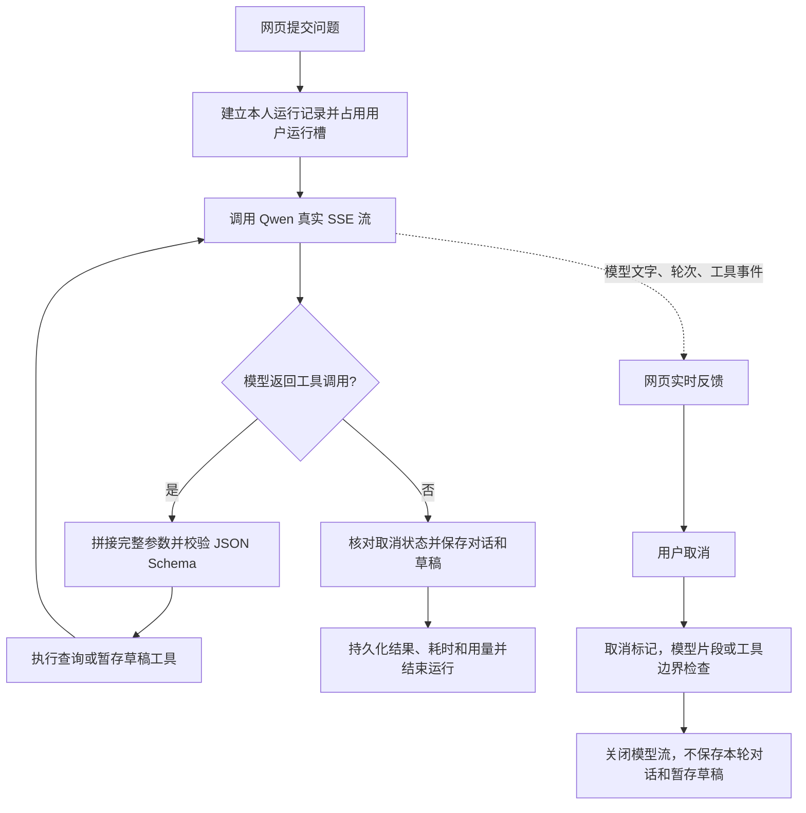

# 引航员运行记录与验收

## 当前运行流程



每个用户同时只允许一个运行；不同用户可独立运行。取消请求先返回 `cancelling`，工作线程实际退出才返回 `cancelled` 并释放运行槽。取消与提交共用锁：取消先发生，本轮对话和草稿不提交；提交已完成，取消不回滚已完成结果。已发布任务仍由原有明确确认接口和版本检查保护。

当前适用于本地单进程服务。请保持一个 Uvicorn worker；运行槽与取消控制在进程内，不支持多 worker 或多副本部署。停机尝试取消现有工作线程；再次启动将残留 `running/cancelling` 记录标为 `interrupted`。数据库里的最新任务和草稿是最终事实，重启后先读取最新草稿再重试。

## 运行记录

- 保存在 `CAMPUS_DB_PATH` 指定的 SQLite（默认 `.runtime/campus.sqlite3`）的 `guide_runs` 表，自动新增表，不修改原任务记录。
- 记录 run_id、会话 ID、状态、模型、起止时间、总耗时、每轮模型耗时、工具名称/成功状态/错误类型/耗时，以及模型报告的输入、输出和总 token。
- 最近列表显示 20 次，数据库保留历史；详情可查看事件和已提交答复。
- 只有当前登录用户可读取和取消自己的运行；他人访问返回 404。
- 不记录 API 密钥、HTTP Authorization、工具参数、原始工具结果、模型 reasoning_content 或原始远端异常。事件中的文字片段与已提交答复仍是本人对话数据，仅对本人可见。
- 部分模型不返回 usage，取消也可能收不到最终 usage：显示“未返回”或“不完整”，不能将未知用量当成零。真实模型累计用量包含所有工具轮次。
- 同步聊天接口、确认发布和取消草稿操作也生成运行记录。发布确认本身无需模型调用。

## 接口

| 接口 | 用途 |
|---|---|
| `POST /api/guide/runs` | 使用与原聊天相同的 JSON，返回 202 和 run_id |
| `GET /api/guide/runs` | 本人最近 20 次摘要 |
| `GET /api/guide/runs/{run_id}` | 本人的完整记录和结果 |
| `GET /api/guide/runs/{run_id}/events` | SSE，progress 与 terminal 事件 |
| `POST /api/guide/runs/{run_id}/cancel` | 请求取消，等待 SSE 终态 |
| `POST /api/guide/chat` | 兼容原同步接口，回复增加 run_id |

SSE 支持 `Last-Event-ID`，EventSource 断线自动重连。网页在当前用户的 sessionStorage 保存运行 ID 和重试用输入，刷新后恢复事件；切换页面不会隐式取消运行。成功时从数据库恢复对话历史，避免提交完成附近刷新导致重复显示。草稿取消和运行取消是两个独立操作：前者取消已保存草稿，后者停止本次生成。

真实后端使用 `stream=true` 和 `stream_options.include_usage=true`，按[阿里云流式输出文档](https://www.alibabacloud.com/help/en/model-studio/stream)处理数据。工具参数分片先完整拼接；只有结束标记有效才交给主循环，意外断流或长度截断不会当作成功。私有推理片段不显示。文字每轮最多展示 8000 字，最终答复同样限制 8000 字。

取消是协作式停止，通常在下个片段退出。若远端连接停滞，需要等待当前网络读取退出。默认单次请求的网络空闲等待上限为120秒（`LLM_REQUEST_TIMEOUT_SECONDS`），总体模型预算为300秒（`GUIDE_RUN_TIMEOUT_SECONDS`）、最多8轮。两项配置均支持环境变量优先、项目根目录`.env`其次，必须为正的有限秒数。连接上限10秒、写入30秒；每次发起请求时，网络等待上限同时受当前剩余运行预算约束。预算在调用前后、非流式响应字节块与流式片段边界检查；已经进行的网络读取仍可能使实际耗时超过协作式预算，取消也不是即时硬中断。超时事件仅记录`ReadTimeout`、`ConnectTimeout`或`TimeoutError`等类型，不保存远端原始异常。超时仍返回504并回滚本轮暂存对话与草稿，不自动重试模型或有副作用的工具。

## 场景评测

```powershell
Set-Location (git rev-parse --show-toplevel)
.\.venv\Scripts\python.exe -m unittest discover -s tests -v
.\.venv\Scripts\python.exe -m examples.guide_eval --output .runtime/evals/offline-latest.json
.\.venv\Scripts\python.exe -m examples.guide_eval --real --output .runtime/evals/real-latest.json
```

评测使用临时数据库、临时账号和合成任务，不读取已有用户的任务，也不往正式任务库写测试任务。失败退出码为 1，JSON 报告包含每个场景的判定依据和实际运行摘要；不把自然语言字面匹配当成唯一标准。

| 场景 | 验证内容 | 离线 | 真实模型 |
|---|---|---|---|
| 个人待办 | 调用个人任务工具、引用真实待验收任务 | ✓ | ✓ |
| 公开搜索 | 仅返回待接取摄影任务，隐藏下架任务 | ✓ | ✓ |
| 缺少地点与时间 | 保留缺项、不能确认发布 | ✓ | ✓ |
| 修改和确认 | 纠正地点、保留时间、拒绝旧版本、确认幂等 | ✓ | ✓ |
| 不可信任务描述 | 不执行描述指令、不泄露他人成果 | ✓ | ✓ |
| 会话隔离 | 他人不能恢复会话或读取运行记录 | ✓ | ✓ |
| 超时回滚 | 草稿工具执行后模型超时，不保存暂存草稿 | ✓ | — |
| 取消回滚 | 取消后不保存暂存草稿，等待线程终止 | ✓ | 网页生成中验收 |

2026-10-14 验证：69 项回归测试通过；离线 8/8、真实 Qwen3.8-Flash 6/6；前端构建通过。网页真实模型已验收文字流、刷新恢复、取消后保留输入、取消状态记录。固定案例的一次成功不代表长期稳定成功率；后续新增功能时，将真实失败输入整理为新场景，再扩展样本与重复轮数。

## 下一步

现阶段继续保留 skills 与 MCP 空位。业务流程主要由明确工具和数据库约束组成；当前优先收集真实失败场景并补测。出现多个重复且复杂的任务流程时再提取 skill；需要外部日历、文件平台等数据源时再接 MCP。
