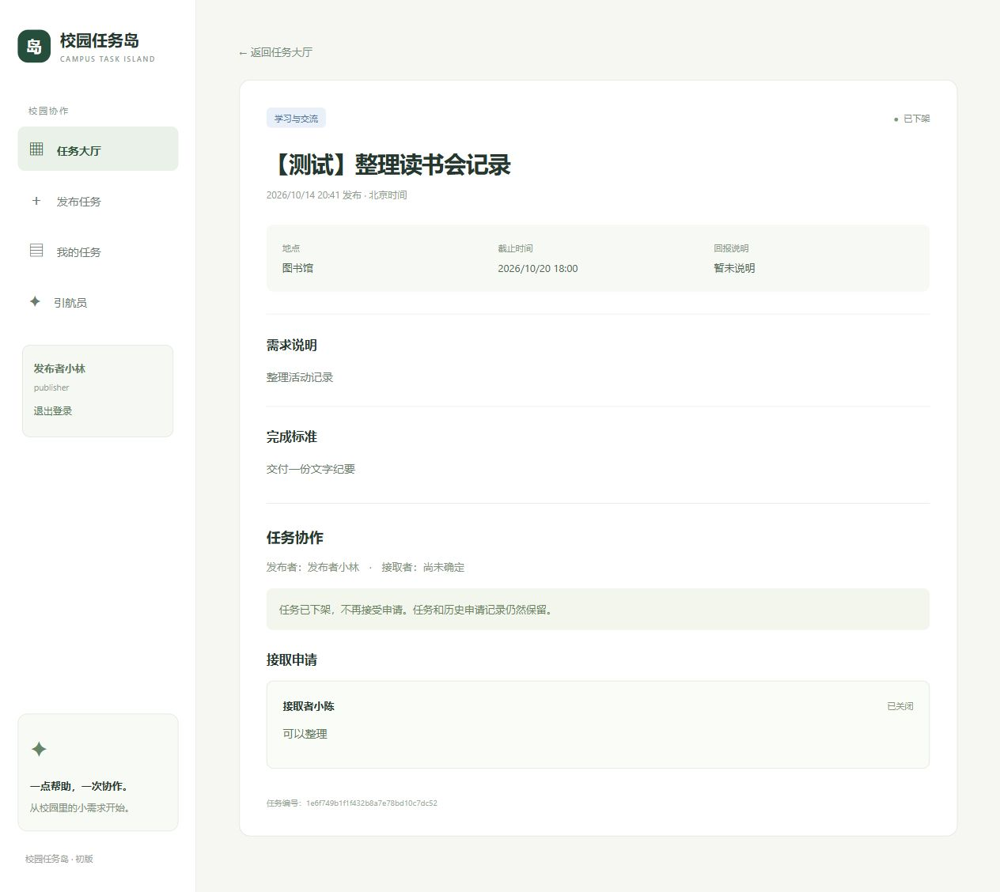

# 最小任务协作

已实现单人接取闭环：发布 → 申请 → 发布者接受 → 接取者提交成果 → 发布者验收。退回补充后回到协作中，允许再次提交，保留每次成果和修改意见。

## 本地测试账号

服务第一次启动会生成三个账号，密码随机生成，只保存在本地 .runtime/campus.accounts.json：

| 账号 | 昵称 | 使用方式 |
|---|---|---|
| publisher | 发布者小林 | 管理原来的任务或发布新任务 |
| helper | 接取者小陈 | 申请任务、提交成果 |
| observer | 同学小周 | 测试另一位申请者和权限边界 |

```powershell
Set-Location (git rev-parse --show-toplevel)
Get-Content .\.runtime\campus.accounts.json -Encoding utf8
```

到 http://127.0.0.1:8000/#/login 输入账号和对应密码。账号只是预置测试用户，任何账号发布新任务后都具有该任务的发布者权限；权限依据当前登录身份和任务归属判断，不是依据账号名称。

已运行的服务无需再次启动。服务停止后使用原来的 uvicorn 启动命令即可，账号、会话和任务记录保存在数据库中。

## 走通一次协作

1. 用 publisher 登录，发布任务或使用已有待接取任务，然后退出登录。
2. 用 helper 登录，进入任务详情，填写申请理由并提交。
3. 切换回 publisher，在详情的“接取申请”中选择接受，任务进入协作中。
4. 切换到 helper，提交成果说明，任务进入待验收。
5. publisher 查看成果，点击确认完成；或填写意见后退回补充。
6. 双方在“我的任务”分别查看我的发布、我的接取和我的申请。

同一个浏览器的多个标签共享登录 Cookie，演示时按以上顺序退出并登录切换；不同浏览器或独立浏览器会话可分别保持两位用户身份。

## 规则

发布者可以在任务详情页下架尚未接取的任务；有待确认申请也可以下架，申请在同一事务中关闭。已接取、待验收和已完成任务不能下架。下架后大厅、Agent 搜索和个人待办不展示该任务；“我的发布”和任务详情保留已下架状态与原有申请记录。下架和接受申请并发时由数据库事务保证只允许一方成功。

数据库以 is_listed=0 保存下架标记，业务接口统一返回 status=withdrawn，原有协作状态及历史保留。数据库版本 3 用 ADD COLUMN 迁移；迁移前生成 SQLite 备份，现有字段不重写。旧任务缺失地点或截止时间时仍可读取原值，新增普通发布和 AI 草稿确认必须补齐这两项。

- 读取公开任务不要求登录，发布、申请、提交和验收要求登录。
- 不能申请自己发布的任务；只有发布者可接受申请和验收。
- 一条任务只接受一位接取者；接受后其他待处理申请自动关闭。
- 只有该任务的接取者可提交成果；等待验收或已完成时不能再次提交。
- 退回必须附带修改意见，再次提交生成新成果记录，不覆盖旧成果。
- 发布者看到全部申请；申请者只看到自己的申请；成果只对发布者与接取者开放。
- 完成后不能再次验收。无权限返回 403，状态冲突返回 409，未登录返回 401。

任务状态：published 待接取、in_progress 协作中、pending_review 待验收、completed 已完成。大厅默认隐藏已完成任务；完成后的记录保留在双方“我的任务”和详情中。Agent search_tasks 仍默认查询待接取任务。

“我的申请”只显示等待确认的申请；已接受的任务转到“我的接取”，已关闭的申请也不占用该列表。历史申请仍保存在任务记录中。成果提交只需文字说明，已移除网址输入和展示，历史网址数据在旧数据库列中保留。

## 协作控制与申请历史

申请者可以按申请记录 ID 撤回自己的待处理申请。相同请求 ID 的重试返回原记录；明确重新申请会创建新记录。每位用户同一任务最多一条有效申请，旧撤回或拒绝记录保留在任务详情和“我的申请”历史中。撤回与发布者接受申请并发时由同一写事务决定唯一结果。

已接取任务的任一方可以申请暂停、恢复或协商取消，另一方确认后生效。确认前协作继续；暂停后阶段开始、成果提交和验收均冻结。暂停时可以明确同时申请延长整体截止时间，只有对方批准且批准时新时间仍晚于服务端当前时间才写入；阶段截止时间不随暂停调整。恢复后按原有截止时间判断逾期。

待验收的整项或阶段成果不能通过取消绕过，须先处理验收并退回补充。已取消任务有独立终态，不计入完成数；阶段、成果、变更、验收和结算历史仍保留。已取消任务不可恢复，发布者可复制基本约定到新任务表单，但需重新填写截止时间，参与者、申请、阶段和结果不会复制。

有偿任务取消时，申请需填写 0 至原报酬的协商金额和原因。零金额显示双方约定无需结算；正金额由付款方和收款方分别确认，原任务报酬约定不被改写。历史回报未分类的任务不推断金额，也不开放结构化取消结算。

约定变更、暂停、恢复和取消共用唯一待处理申请。成果提交、阶段推进、审批、撤销及任务结束均在事务内校验版本并使旧申请失效或关闭；业务状态、历史和消息共同提交。成果提交与验收携带协作版本，暂停／恢复后旧页面提交会收到冲突提示。

| 接口 | 用途 |
|---|---|
| `POST /api/applications/{id}/withdraw` | 申请者撤回本人的待处理申请 |
| `POST /api/tasks/{id}/collaboration-requests` | 以 `action: pause/resume/cancel` 提出协作控制，绑定约定和协作版本 |
| `POST /api/task-changes/{id}/review` | 对方确认或拒绝协作控制申请，拒绝原因必填 |
| `POST /api/task-changes/{id}/cancel` | 提出者撤回待处理协作申请 |
| `GET /api/tasks/{id}/copy-source` | 原发布者读取已取消任务的可复制基本约定 |

schema 13 扩展任务状态与申请历史约束，保留旧任务及申请 ID、内容和归属，并增加协作版本、暂停／取消说明、请求 ID 和撤回时间。任务状态表与申请表会受控重建以扩大检查约束，迁移后执行外键核验；任务变更表追加控制类型，旧统一变更和延期记录保持兼容。

“我的任务”三个列表按待接取、协作中、待验收、已完成、已下架排序；同一状态按发布时间降序，同一发布时间按任务 ID 降序保持顺序稳定。

## API

| 接口 | 用途 |
|---|---|
| POST /api/auth/login | 账号密码登录，设置 HttpOnly 会话 Cookie |
| GET /api/auth/me | 当前用户 |
| POST /api/auth/logout | 退出当前登录会话，保留账号和业务记录 |
| GET /api/me/tasks | 我的发布、接取、申请 |
| GET /api/tasks/{id}/workspace | 本人有权限查看的申请与成果 |
| POST /api/tasks/{id}/applications | 提交 reason |
| POST /api/applications/{id}/accept | 发布者接受申请 |
| POST /api/tasks/{id}/submissions | 只提交 summary 成果说明 |
| POST /api/tasks/{id}/review | decision 为 accept 或 request_changes，feedback 为意见 |

Swagger 发布任务前需先使用登录接口。同源前端自动携带 Cookie，后端从会话确定用户，不接收调用方伪造的发布者或申请者 ID。

## 迁移与验收

旧数据库迁移前自动用 SQLite backup 生成 .runtime/campus.before-collaboration-时间.sqlite3。旧任务 ID、内容、创建时间和状态保留，无身份的历史任务登记到 publisher。已完成验收的数据使用独立 .runtime/collaboration-ui.sqlite3，不修改真实任务的协作状态。

2026-10-14：29 项测试通过，前端 TypeScript 检查和生产构建通过。覆盖并发接受时只有一人成功、越权拒绝、申请和验收重复请求、多余提交字段、待确认申请筛选、过期会话、跨站请求来源、历史库迁移；浏览器双账号完成申请、接受、提交、退回、再提交和验收，并验证刷新后保留记录及双方的“我的任务”。

本轮没有增加实时聊天、付款、文件上传、注册或学校认证。

下架与必填规则新增七项测试，全部 62 项测试通过；浏览器在独立测试库验证下架后申请关闭、大厅隐藏、详情保留，以及普通发布表单和真实 Qwen 草稿的必填提示。正式库迁移前生成备份，迁移后原有任务、申请与成果字段校验一致。



## 接取规则更新

普通任务现支持直接接取和申请后确认，三项填写要求可配置；重复申请改为返回原记录。旧任务默认规则保持兼容，详见 [ACCEPTANCE.md](ACCEPTANCE.md)。

## 截止与回报规则更新

普通任务已增加截止控制、最小双方延期和有偿任务线下结算确认；新发布需明确回报类型，旧回报文字不推断分类。详见 [TERMS.md](TERMS.md)。
## 协作撤回、暂停与取消（2026-10-15）

普通任务现支持撤回待处理申请、以新申请记录重新申请，以及双方确认的暂停、恢复和协商取消。暂停冻结阶段推进、成果提交与验收；恢复按当前截止时间继续执行。取消为独立终态，保留协作历史，不计入完成数；发布者可将已取消任务的基本约定复制到新建表单，截止时间需重新填写。

验收：后端完整测试 273 项通过，前端 TypeScript 检查与生产构建通过。临时数据库双账号网页走通申请撤回与重新申请、接受、暂停及冻结、恢复、协商取消、历史显示和复制表单。正式库迁移前备份为 `.runtime/campus.before-lifecycle-20261015-150743.sqlite3`；正式库由 schema 12 迁移至 13，36 张既有表保留，任务 5 条及申请 2 条原有字段逐行一致，`foreign_key_check` 无问题。正式服务已在 `http://127.0.0.1:8000` 启动。
