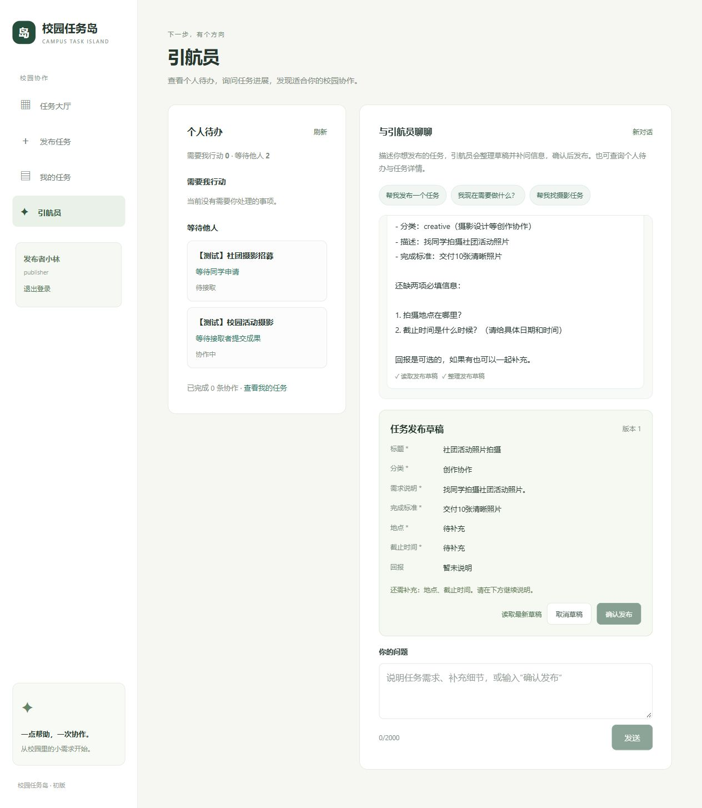

# 网页引航员与活动筹备

2026-10-17更新：志愿与综素活动已支持独立方案草稿、岗位建议与筹备清单；新增参与偏好授权、后台持续机会匹配与站内提醒、实时及历史调用轨迹。当前使用说明见 [活动筹备与参与助手](PROPOSAL_ALIGNMENT.md)。下文较早的工具列表和验收记录保留作历史参考。

> 后续更新：协作延期已统一为双方约定变更，接取后首次阶段安排也须双方确认。当前规则、接口及兼容说明见 [统一变更申请](CHANGES.md)。


登录后打开 `http://127.0.0.1:8000/#/guide`，或点击侧栏“引航员”。左侧个人待办直接读取数据库，即使模型未配置也能使用。右侧聊天支持 AI 辅助发布、普通任务查询，以及综素活动、志愿服务、校园发现和跨板块个人概览的只读查询。

## 普通任务与综素活动

现有四类内容提示词、工具描述和网页说明分别标注。志愿服务按岗位报名、记录参与并由负责人确认分钟数；引航员可以查询岗位名额、本人的报名和小时记录，但不代报名或确认小时。志愿模块详见 [VOLUNTEERS.md](VOLUNTEERS.md)。

普通任务工具包括搜索、个人任务、详情和当前有效约定查询；详情区分现行约定、待处理变更、逾期、暂停和取消。系统提示词和工具描述明确区分普通协作与综素活动，并在类型不明确时要求先询问。“找同学拍社团活动照片”属于普通任务；“组织美育工作坊供同学报名”属于综素活动。普通任务搜索为空不能用于判断有没有综素活动，也不能将活动认定标签或报名名额套入普通任务规则。

综素活动可由引航员搜索活动、读取详情与本人报名结果；从左侧“发布任务”选择“综素活动”发布，从“我的空间 → 我的报名”查看历史。活动报名成功不自动获得学分。提示词用于约束模型的解释与选择；数据表、查询范围与写入权限仍由代码控制。

真实模型场景验收使用临时数据库，不写入正式任务，命令会调用 `.env` 中配置的远端模型：

```powershell
.\.venv\Scripts\python.exe -X utf8 -m examples.guide_type_check
```

场景覆盖综素活动发布引导、活动名额查询能力边界、模糊类型追问、普通活动摄影协作草稿。报告位于 `.runtime/evals/content-type-real-latest.json`；固定场景的单次通过不代表模型永不误分类。

2026-10-15：上述 4 个真实模型场景全部通过，综素活动请求未生成普通任务草稿或调用普通查询工具，含糊类型先追问，普通活动摄影协作生成完整草稿。新增 2 项工具隔离与提示词传递检查，全量 119 项测试通过，前端类型检查和生产构建通过。网页验证统一选择页、两类表单刷新、登录后返回所选类型、无活动发布权限提示，以及引航员说明链接返回统一入口。

## AI 辅助发布

1. 描述需求，例如“我想找同学拍社团活动照片”。
2. 引航员用工具整理已知信息，并询问缺失的必填项。标题、分类、需求说明、完成标准、地点和截止时间均为必填；新发布还必须明确回报类型，无偿说明可选，有偿金额及说明必填。地点和时间必须由用户说明，模型不能自行猜测。
3. 网页展示任务草稿卡片；继续对话可修改内容、清除可选字段。必填项不完整时“确认发布”不可用。
4. 核对卡片后点击“确认发布”，或在网页输入完整的“确认发布”/“确认发布任务”。后台创建真实任务，卡片显示详情入口，并更新个人待办。

模型只开放整理草稿工具，没有直接创建任务的工具。发布者由登录会话绑定，不能由模型传入。确认绑定草稿版本；草稿修改后，旧版本的确认会被拒绝。任务创建、草稿标为已发布及确认对话记录在同一 SQLite 事务中完成；同一版本重复确认返回同一任务。此保护只适用于草稿确认，不改变普通发布表单的重复提交行为。

草稿独立保存在 guide_task_drafts，不会因为只保留最近五轮对话而丢失。AI 调用失败时，已保存草稿与对话不被半途修改。页面用按用户区分的 sessionStorage 保存对话 ID，刷新及同一标签返回可恢复服务端最近对话和草稿；不在浏览器保存模型推理内容。跨用户读取草稿或确认返回 404。

点击“取消草稿”或输入“取消草稿”/“取消发布”只取消尚未发布的草稿。一份对话中的草稿发布或取消后不能继续修改；点击“新对话”整理另一项任务。取消草稿不能撤回已发布任务。

## 模型配置

网页服务读取 项目根目录下的 **`.env`**，每次对话重新加载，配置更新不需要重启。环境变量优先于文件；变量名也兼容 DEEPSEEK_API_KEY / DEEPSEEK_BASE_URL / DEEPSEEK_MODEL。该文件已加入 `.gitignore`。只在本机填写密钥。

首次配置可复制 `.env.example` 为 `.env`，填写：

```dotenv
LLM_API_KEY=<本机填写百炼北京地域密钥>
LLM_BASE_URL=https://dashscope.aliyuncs.com/compatible-mode/v1
LLM_MODEL=qwen3.8-flash
```

2026-10-14 已按阿里云百炼北京地域配置 Qwen3.8-Flash，并在用户确认密钥地域后通过真实模型验收。模型 ID 和工具调用支持见 [官方模型说明](https://help.aliyun.com/zh/model-studio/qwen3-8-flash)。北京地域原有 dashscope 域名仍可正常使用；新业务空间专属域名也可使用，见 [OpenAI 兼容接口说明](https://help.aliyun.com/zh/model-studio/compatibility-of-openai-with-dashscope)。API Key 必须来自同一地域；DeepSeek 官方密钥不能用于百炼接口。

若已在自己的 PowerShell 设置好三个变量，可在项目根目录执行以下脚本保存当前值。三个变量齐全时才写入；会覆盖同名文件，应保留文件中其他自定义设置。

```powershell
if (!$env:LLM_API_KEY -or !$env:LLM_MODEL -or !$env:LLM_BASE_URL) {
    throw '请先配置 LLM_API_KEY、LLM_MODEL、LLM_BASE_URL'
}
@(
    "LLM_API_KEY=$env:LLM_API_KEY"
    "LLM_BASE_URL=$env:LLM_BASE_URL"
    "LLM_MODEL=$env:LLM_MODEL"
) | Set-Content -LiteralPath .\.env -Encoding utf8
```

CLI 仍使用环境变量。`.env` 的 CAMPUS_DB_PATH 不在这里加载；数据库路径继续使用启动环境变量。

### CAMPUS_DB_PATH

这是本地 SQLite 数据库文件的路径。任务、账号密码散列、登录会话、申请、成果和引航员对话存储在这个文件中，重启服务后保留。留空或不设置时，默认使用 项目根目录下 `.runtime/campus.sqlite3`，当前项目继续使用这个已有数据库。

目前这个变量只从服务启动进程的环境中读取，`.env` 仅加载模型配置。若确实需要指定其他数据库，在启动服务器的 PowerShell 中设置：

```powershell
$env:CAMPUS_DB_PATH = Join-Path (Get-Location) '.runtime\campus.sqlite3'
```

数据库路径在启动时确定，修改需要重启服务。切换到新文件会建立独立数据库，不会自动搬迁原有任务，测试账号文件也会与该数据库对应生成。仅切换引航员模型时不用修改此项。

## 工具与权限

模型响应只有以`stop`或`tool_calls`正常终止后，才交给Agent处理。非流式完整响应若被截断、过滤、缺少终止原因或包含未知终止原因，同步接口返回502；流式中间片段可以暂时没有终止原因，但整条流须正常终止。异常响应中的工具调用不执行；此前轮次仅在内存中暂存的草稿、阶段建议和本轮对话不提交，原有已保存数据保留，失败运行记录仍可查看。正常回答和正常工具调用继续沿用原流程，失败后可以重新提问。

| 工具 | 作用 | 参数 |
| --- | --- | --- |
| search_tasks | 搜索待接取任务 | keyword、category、limit（1–5）、offset |
| get_my_tasks | 当前用户发布、接取、待确认申请及待办 | limit（1–5）、offset、include_completed（默认 false） |
| get_task_detail | 任务详情及本人可见的申请、成果 | task_id |
| search_activities / get_activity_detail | 搜索综素活动、读取详情和本人报名结果 | keyword、recognition_tag、分页 / activity_id |
| get_my_activity_registrations | 当前用户综素报名结果与重试历史 | limit、offset |
| search_volunteer_jobs / get_volunteer_detail | 按岗位搜索与分页、读取岗位名额与本人报名 | keyword、limit（1–5）、offset / activity_id |
| get_my_volunteer_registrations / get_my_volunteer_records | 本人志愿报名、参与记录与活动方确认分钟 | limit、offset |
| search_discoveries / get_discovery_detail | 搜索当前可见发现、读取详情和状态来源 | keyword、分类、状态、分页 / discovery_id |
| get_my_overview | 跨板块行动待办与等待事项、完成和未读摘要 | limit（1–5） |
| get_task_draft | 读取当前对话的发布草稿 | 无 |
| update_task_draft | 合并用户提供的草稿字段，不创建任务 | title、category、description、completion_criteria、location、deadline、reward 的部分字段 |

`search_volunteer_jobs` 的 `items`、`total`、`limit`、`offset` 全部以岗位为单位：先匹配关键词，再计数和分页，`total` 为全部匹配岗位数，越界页仍保留该总数。活动标题、介绍或组织名称匹配时返回该活动的所有岗位；仅岗位名称、说明、要求或地点匹配时只返回匹配岗位。按活动开始时间、活动ID、岗位顺序、岗位ID稳定排序。一次查询使用同一只读快照和服务端时间，名额与本人报名状态复用现有规则；未取消且未结束的活动可被搜索，满额、报名截止或尚未开放不额外隐藏。网页志愿活动列表仍按活动分页。

用户 ID 由服务端 Cookie 会话绑定，不接受前端或模型传入。全量个人待办接口不受工具分页限制；工具返回每组总数，offset 分别作用于每组。详情的申请最多取三条、成果最多取两条，并截取长材料，提供 record_totals 与 collaboration_preview 标识。旁观者只能看到公开任务内容和自己的申请，不能看到其他申请或成果。聊天注册表不包含文件、Shell、接取或验收写工具。

跨板块概览把当前需要本人操作的 `todos` 与正在等待负责人审核、候补递补或对方协作的 `waiting` 分开。活动和志愿名额、报名状态及小时都取自本次工具查询，回复应说明结果中的 `server_time`，并提示报名操作会由服务端重新检查。志愿小时显示活动方确认值；学校正式认定状态为 `not_connected`。校园发现 `status_source=author_report` 表示发布者自报，不能描述为工作人员确认。校园发现详情使用当前账号权限读取；撤回内容对非发布者仅返回撤回占位信息。

任务描述和协作材料作为不可信内容提示给模型。回答中的自然语言由模型生成，工具查询权限与数据库待办规则由代码执行。网页以纯文本显示回答，详情链接仅从成功工具查询结果生成，不渲染模型提供的 HTML。

## 待办规则

| 身份和状态 | 分类 | 下一步 |
| --- | --- | --- |
| 发布者、待接取、无申请 | 等待他人 | 等待同学申请 |
| 发布者、待接取、有待确认申请 | 需要我行动 | 查看并选择接取者 |
| 发布者、协作中 | 等待他人 | 等待接取者提交成果 |
| 发布者、待验收 | 需要我行动 | 验收或说明需要补充的内容 |
| 接取者、协作中 | 需要我行动 | 完成并提交成果说明 |
| 接取者、待验收 | 等待他人 | 等待发布者验收 |
| 申请者、申请待确认 | 等待他人 | 等待发布者确认申请 |
| 已完成 | 不列为待办 | 保留完成计数与我的任务历史 |

申请被接受或关闭后，不列入待确认申请；退回补充后，接取者重新获得提交待办。规则在一次数据库读事务中计算，刷新页面或点击“刷新”可读取最新状态。

## HTTP 接口

`GET /api/guide/todos`：登录后返回 published、assigned、applied、todos、waiting、completed_count。

`POST /api/guide/chat`：登录后发送 JSON：

```json
{"message":"我现在需要做什么？"}
```

响应包含 conversation_id、answer、references、tools_used、mode、draft。mode 为 model（真实模型）、offline_demo（离线测试脚本）或 action（程序执行确认/取消）。继续对话时带上 conversation_id；可选 task_id 为当前任务提供上下文。客户端不能传 user_id、history 或 system 指令。对话历史保存在 guide_conversations，按用户隔离，最多保存最近五轮；模型协议需要的 reasoning_content 只保存在服务器，不返回网页。

输入精确的“确认发布”/“确认发布任务”或“取消草稿”/“取消发布”时，须同时提供当前 draft_version。网页自动携带版本；程序直接执行对应动作，不再请求模型。其他自然语言发布意图会先由模型整理草稿。

| 接口 | 用途 |
| --- | --- |
| GET /api/guide/conversations/{conversation_id} | 恢复本人的最近文本对话与最新草稿，不返回 reasoning_content |
| POST /api/guide/drafts/{conversation_id}/publish | 请求体 {"version":1}，确认发布该版本；重复确认返回同一任务 |
| POST /api/guide/drafts/{conversation_id}/cancel | 请求体 {"version":1}，取消尚未发布的草稿 |

草稿不存在、不完整、已取消或版本已更新时返回 409。确认接口独立于模型配置，模型暂不可用时仍能发布已经完整的草稿。

每个请求创建独立 AgentLoop，最多八轮模型调用，HTTP 调用超时 45 秒，调用前后检查 120 秒总预算（检查不能立即中断已发出的同步调用）。同一用户已有请求时返回 409；此限制适用于当前单进程服务，多进程部署需共享并发控制。接口非流式。模型缺配置返回 503；远端失败或轮数耗尽返回 502；超时返回 504。失败不会保存无效对话轮次或修改任务状态。

## 验证与离线演示

```powershell
.\.venv\Scripts\python.exe -m unittest discover -s tests -v
Set-Location web
npm.cmd run build
```

另外提供独立离线网页服务器：在项目根目录执行 `python -m examples.guide_demo --port 8001`，访问 `http://localhost:8001/#/guide`。程序输出临时测试账号文件路径；退出后临时数据库删除。请使用 localhost 与正式服务的 127.0.0.1 隔离 Cookie。

离线演示仍真实调用数据库与草稿工具，但回答由固定测试脚本构造，网页标注“离线测试模型”。可加 --real-model 显式使用真实模型，数据仍为临时测试库。正式服务不会自动回退到演示模型。

`python -m examples.guide_publish_check` 会读取项目模型配置，在临时数据库使用真实模型完成追问、补充草稿、确认发布与重复确认验证。会发生远端模型调用，不使用正式任务库。

2026-10-14 Windows 验收：62 项自动测试通过，TypeScript 检查与 Vite 构建通过。真实 Qwen3.8-Flash 在临时数据库验证缺失地点与截止时间时追问、补齐六项必填后确认发布及重复确认。

四类真实数据查询使用的只读工具与场景评测命令：

```powershell
.\.venv\Scripts\python.exe -X utf8 -m examples.guide_eval --read-only
.\.venv\Scripts\python.exe -X utf8 -m examples.guide_eval --read-only-real
```

离线评测覆盖跨板块待办、综素候补、志愿岗位名额、志愿小时记录和校园发现状态来源；真实模型抽测覆盖跨板块待办、活动候补与发现状态来源。所有场景均使用临时数据库和合成账号，不读取正式用户数据。报告保存在 `.runtime/evals/`。

真实模型网页验收验证了缺失信息时禁止发布、补充并修改标题、刷新恢复草稿、按钮确认后创建真实任务、个人待办同步、新任务详情刷新、返回引航员恢复已发布卡片，以及切换账号后不显示他人的草稿。正式库任务、申请与成果数据在更新服务前后校验一致。

地点和截止时间的必填规则同时由普通表单、草稿完整性检查和最终新增写入校验执行。历史任务保留原有空值，读取不受影响，系统不伪造时间或地点。



## 四类内容边界

引航员区分普通任务、综素活动、志愿服务和校园发现。校园发现用于提醒、分享和情况补充，指引到校园发现页面或统一发布入口；不写入普通任务草稿，不代发布、评论、改状态，不宣称已经核实设施或安全情况。四类边界真实模型验收见 `.runtime/evals/discovery-guide-real-latest.json`（8场景）。

首页与消息入口：`/#/home` 查看实时待办，`/#/messages` 查看已发生的参与反馈。消息已读不表示待办完成。引航员不代读取或标记消息；旧的普通任务与草稿工具保持原范围。

## 接取规则草稿

普通任务草稿和确认卡片现包含接取方式及申请理由、技能经验、补充说明的填写规则。未指定时说明兼容默认值，有歧义先补问；配置更改沿用草稿版本确认保护，详见 [ACCEPTANCE.md](ACCEPTANCE.md)。

## 截止与回报规则更新

普通任务已增加截止控制、最小双方延期和有偿任务线下结算确认；新发布需明确回报类型，旧回报文字不推断分类。详见 [TERMS.md](TERMS.md)。
