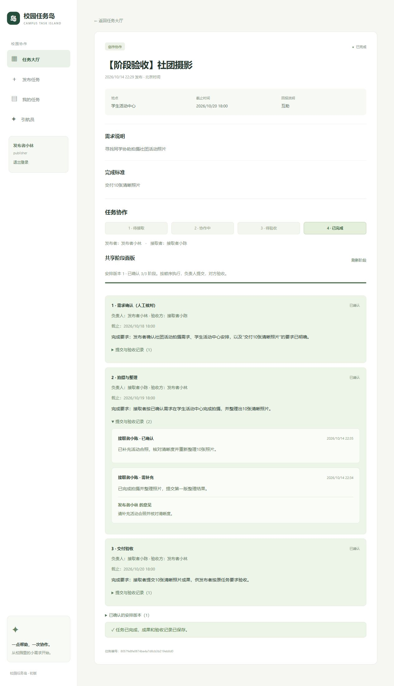

# 共享阶段面板

> 后续更新：协作延期已统一为双方约定变更，接取后首次阶段安排也须双方确认。当前规则、接口及兼容说明见 [统一变更申请](CHANGES.md)。


一项普通任务现在可以按顺序划分 1 到 8 个阶段。双方在同一任务详情中查看阶段安排、分工、进度、提交与验收历史；引航员根据真实任务要求提出结构化建议，由发布者编辑并确认后生效。

## 使用步骤

1. 发布者打开待接取任务，或打开尚无整项成果提交记录的协作任务。
2. 在“共享阶段面板”选择“手动设置阶段”或“AI 阶段建议”。可补充希望的分工与时间安排。
3. AI 会先调用 `get_task_detail`，再调用 `propose_task_stages`。建议显示为待确认卡片，不会改变任务或阶段安排。
4. 点击“将建议填入编辑区”，核对或修改阶段名称、完成要求、负责人和截止时间，点击“确认阶段安排”。
5. 正式接取后，当前阶段负责人点击“开始本阶段”，填写成果说明并提交。后面的阶段等待前置阶段确认。
6. 对方确认该阶段，或填写意见后退回补充。退回后负责人点击“继续本阶段”，修改成果并重新提交，历史记录保留。
7. 最后一个阶段确认后，整项任务变为“已完成”，双方阶段待办清空；有偿任务仍可能需要确认线下结算，记录在“我的任务”和详情中保留。

角色沿用当前的发布者和一位接取者。阶段可以由任一方负责，负责人提交，对方验收：接取者负责的阶段由发布者确认；发布者负责的阶段由接取者确认。不会允许本人确认本人提交。尚未确定接取者时可先确认计划，成员加入后自动绑定相应身份。

每个阶段明确名称、完成要求、负责人和带时区的截止时间。网页统一以北京时间输入和展示；阶段截止时间按执行顺序不递减，且不晚于任务截止时间。历史任务没有任务截止时间时，需手动确定阶段日期，或在 AI 补充要求中说明日期。

## 状态与待办

| 阶段状态 | 负责人下一步 | 对方下一步 | 整项任务状态 |
|---|---|---|---|
| 未开始 | 开始当前阶段 | 等待对方 | 协作中 |
| 进行中 | 提交本阶段成果 | 等待对方 | 协作中 |
| 已提交 | 等待验收 | 确认或退回本阶段 | 待验收 |
| 需补充 | 继续阶段并补充成果 | 等待重新提交 | 协作中 |
| 已确认 | 进入下一阶段 | 按下一阶段分工行动 | 协作中，最后阶段确认后为已完成 |

“我的待办”和 `get_my_tasks` 使用同一数据库快照，依据当前阶段与本人角色计算行动；即使当前阶段由发布者负责，待办也会正确指向发布者，而验收待办指向接取者。

## 约定与权限

- 阶段安排只有发布者可以确认。开始执行前可以替换安排，每个确认版本保留完整快照。
- 开始任一阶段后锁定安排，避免已经提交或确认的记录被覆盖。执行中的延期、分工变更协商仍属于后续功能。
- 前置阶段未确认，不能开始、提交或确认后续阶段。
- 阶段操作携带状态版本；安排确认携带计划版本。旧页面、重复提交和并发操作返回冲突，刷新后核对最新状态。
- 双方看到相同的已确认安排与全部阶段成果；其他登录用户可以查看安排和状态，不能读取成果、验收意见或安排版本历史。
- 未确认的 AI 建议仅发布者本人可见，刷新任务详情后仍可读取。旧版本建议不能直接采用；AI 生成期间若安排发生变更，建议保存也会拒绝覆盖。
- AI 没有确认计划、开始阶段、提交成果、验收或发布任务的写工具。模型失败、超时或取消不会保存本轮建议与对话。
- AI 运行继续使用运行记录、SSE 进度、刷新恢复和取消机制。模型配置沿用 `.env`。

## 原有任务兼容

数据库版本 5 新增阶段安排、版本快照、阶段、阶段成果和 AI 建议表，原任务与成果字段不重写。

未设置阶段的任务继续原来的整项提交和验收流程。已有整项成果提交记录的任务继续原流程；已完成或下架任务不能设置新阶段。采用阶段后，网页隐藏原整项提交与验收表单，后端也拒绝通过旧接口跳过阶段。

本步继续使用文字成果说明，不要求网址或文件上传。多人接取、任务交流和执行中的变更协商由后续业务扩展实现。

## 接口

| 接口 | 用途 |
|---|---|
| `GET /api/tasks/{task_id}/stages` | 本人可见的阶段、安排版本和 AI 建议 |
| `POST /api/tasks/{task_id}/stages` | 发布者确认计划，提交 stages、expected_version 和可选 suggestion_id |
| `POST /api/tasks/{task_id}/stages/{stage_id}/start` | 负责人开始或继续阶段，提交 version |
| `POST /api/tasks/{task_id}/stages/{stage_id}/submissions` | 负责人提交 summary 和 version |
| `POST /api/tasks/{task_id}/stages/{stage_id}/review` | 对方提交 decision、feedback 和 version |
| `POST /api/guide/runs` | purpose 为 stage_plan，指定 task_id 和 message，运行结果含 stage_suggestion |

原同步聊天接口也接受 `purpose: "stage_plan"`。该模式必须指定 task_id；阶段建议没有直接确认生效的模型接口。

## 验证

```powershell
Set-Location (git rev-parse --show-toplevel)
.\.venv\Scripts\python.exe -m unittest discover -s tests -v
.\.venv\Scripts\python.exe -X utf8 -m examples.stage_check
.\.venv\Scripts\python.exe -X utf8 -m examples.stage_check --real
```

`stage_check` 默认验证离线调用链与业务规则；`--real` 使用配置的真实模型。全部数据在临时数据库，报告保存到 `.runtime/evals/stages-offline-latest.json` 或 `stages-real-latest.json`。报告包含实际工具运行摘要、建议内容、每项判定依据和最终阶段统计。

自动测试覆盖顺序提交、退回重提、双方负责/验收角色、待办、权限隔离、计划版本、并发与旧状态拒绝、原接口防绕过、历史兼容、重启保留，以及 AI 建议确认、失败/取消回滚和生成期间的安排变更。

网页验收使用临时任务和真实 Qwen3.8-Flash，验证了生成中刷新恢复、未确认建议刷新保留、人工编辑后确认、双方分阶段提交与验收、退回重提的两次记录，以及刷新后 3/3 阶段确认和整项任务完成。



## 截止与回报规则更新

普通任务已增加截止控制、最小双方延期和有偿任务线下结算确认；新发布需明确回报类型，旧回报文字不推断分类。详见 [TERMS.md](TERMS.md)。
